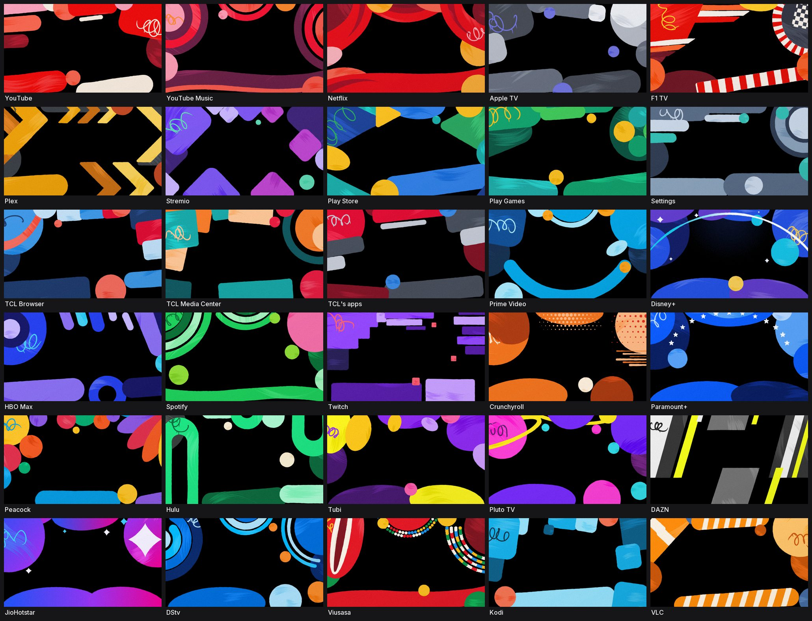

# tv-vibehack

**Your TV, minus the ads.**

Strip the bloatware from any Android TV or Google TV over Wi-Fi, and replace the ad-filled home
screen with a clean launcher that looks like an Apple TV. No root, no cable, nothing uninstalled,
and a one-line restore if you change your mind.


It started as an afternoon fixing my parents' Mi TV, which showed them an advert before they
could reach Netflix. The whole thing was done with Claude Code talking to the real TV, and the
prompt that did it is in this repo so you can do the same with yours.

---

## Table of contents

- [How it works](#how-it-works)
- [Quick start](#quick-start)
- [What you get](#what-you-get)
- [Supported TVs](#supported-tvs)
- [Doing it by hand](#doing-it-by-hand)
- [The launcher](#the-launcher)
- [Troubleshooting](#troubleshooting)
- [Questions people ask](#questions-people-ask)
- [Contributing](#contributing)
- [Licence](#licence)

---

## How it works

Android TVs have the same debug bridge as Android phones. Once you switch on USB debugging in the
TV's developer options, the TV listens on your Wi-Fi and asks you once to allow your computer.
After that, everything is standard Android tooling:

1. **Back up** the list of installed packages and settings.
2. **Disable** the manufacturer's telemetry, ad services, content rows and preloaded junk with
   `pm disable-user`. Nothing is uninstalled, so a restore script can undo every step.
3. **Install** a small native launcher and make it the default home screen.

The bloat differs by brand, which is why the prompt asks your coding assistant to discover it
on your TV and ask you before touching anything you might use.

## Quick start

You need a computer on the same Wi-Fi as the TV and a coding assistant with shell access
(Claude Code, or anything similar).

**1. On the TV**
Settings → Device Preferences → About → press OK on **Build** seven times → go back →
Developer options → turn on **USB debugging**. Some TVs also show a Network or ADB debugging
toggle; turn it on too. Newer ones (Android 11+) may only offer **Wireless debugging**, which
pairs with a code instead; see [Connecting](#connecting). Keep the TV switched on.

**2. On your computer**
Open your assistant, paste the prompt from [`PROMPT.md`](PROMPT.md), and fill in your TV model.

**3. Follow along**
Accept the "Allow USB debugging?" prompt when it appears on the TV, then answer the checklist
questions: which streaming apps you use, which four go in the dock, whether to keep the voice
assistant, Chromecast and firmware updates.

That's it. The assistant backs up, debloats, builds and installs the launcher, and checks every
step with screenshots pulled from the TV. On a 1 GB Mi TV the whole thing took one afternoon the
first time; with this repo as context, people report about fifteen minutes.

## What you get

A home screen that is yours again:

- **Pitch-black background** and a dock of your four favourite apps at the bottom, in a full-width
  panel of **Liquid Glass**, exactly where Apple TV puts it. As on tvOS 26, the top shelf shows through
  it slightly blurred, more colourful and bent along its edges, under a bright rim (Android 12 and
  later; the bending needs Android 13). The top right's capsule is the same glass. How see-through it
  is goes on a slider like Apple's, from the clearest (the default) through Clear, Apple TV's own look,
  to Tinted: hold OK on any app and pick **Adjust Liquid Glass…**.
- **A top shelf like Apple TV's.** With a dock app focused, the whole screen behind the dock shows one
  picture that stays, as Apple TV shows YouTube's: the app's own Apple TV Top Shelf image, once you've
  put it on the TV, or else its artwork: an original picture in its brand's colours and shapes, in the
  manner of YouTube's, with its logo (about 30 apps have one). Otherwise, its name over an ambient glow
  in its colour. Or, app by app in **Home Settings**, what it suggests: what you were watching first
  (with **Resume** a press of Up away), then your watchlist, then the app's own recommendations mixed
  with what's trending on it (Netflix's Top 10 in your TV's country, Apple TV+, Prime Video, Stremio's
  popular titles), each full screen with its title's logo, the next one pushing in every 10 seconds.
  See [The top shelf](#the-top-shelf).
- **Home Settings**, the launcher's own settings on the TV, as an app in the grid like Apple TV's Settings:
  Liquid Glass, and what each app's top shelf shows (its **Picture**, its **App Colour**, its
  **Suggestions**, or its artwork, cover art or a colour of your choice), with a preview of Home as you
  move. See [Home Settings](#home-settings).
- **The rest of your apps in a grid** that glides up on a spring when you press Down, as on Apple TV:
  the dock row moves to the top, the time and profile picture scroll away with the page, and the rows
  get the whole screen. Back on the dock, they come back.
- **Apple TV-style transitions**: opening an app presses its tile in while Home grows toward you and
  fades, and the app comes from behind it; pressing Home or Back, Home falls back into place as it
  fades in, with focus still on the app you opened. Measured from Apple TV recordings; see
  [docs/transitions.md](docs/transitions.md).
- **Apple TV-style focus**: no separate highlight; the focused tile itself grows with a quick spring
  onto a soft shadow, and grid tiles show their name. Left and Right stop at the end of a row.
- **Arrange apps from the remote**: hold OK on an app and pick Move, or use the Arrange Apps tile at the
  end of the grid. The app lifts, chevrons show where it can go, the arrows move it (into and out of
  the dock too) and OK puts it down.
- **The time and your profile picture in the top right**, in a small Liquid Glass capsule, as on Apple TV.
  Press Up from the dock and it opens like the header of Apple TV's Control Center: the time glides
  left and three icon buttons come out from behind the picture, each with a caption saying what it
  does. Inputs (a dropdown of HDMI ports, AV and Live TV), Wi-Fi (showing the network you're on) and
  Settings; on Google TV, Settings opens the TV's quick settings panel, as the remote's Settings
  button does. The picture opens the TV's Accounts & Profiles.
  Down or Back closes it. Measured from Apple TV recordings, down to the spring. Set your name in
  `config.xml` (`profile_name`) to show your initials instead of the silhouette, and pick the
  buttons' look (`top_bar_style`): Control Center's tabs (the default); grouped in one tray with the
  focused button's name underneath, as on Google TV; round icons that open into labelled pills; or
  frosted pills that always show their names.
- **All text is set in [Inter](https://rsms.me/inter/)**, the open typeface closest to Apple TV's
  SF Pro, on a type scale taken from tvOS's text styles (`values/styles.xml`).
- **A matching Clock screensaver**, optional, that drifts around the screen so nothing burns in.

And a TV that stops working against you: no sponsored rows, no "Discover" nags, no analytics
phoning home, no apps you never asked for.

## Supported TVs

Anything running **Android TV** or **Google TV**: Xiaomi and Redmi, TCL, Hisense, Sony, OnePlus,
Realme, Nvidia Shield and most others. The launcher does not require Wi-Fi hardware; Ethernet-only
TVs are supported too.

Not supported: Samsung (Tizen), LG (webOS) and Amazon Fire TV. They run different systems or
won't let a third-party launcher take over Home.

Lists that people have tested and contributed live in [`examples/`](examples/):

| TV | OS |
|---|---|
| Xiaomi Mi TV 4A (MiTV-MOOQ1) | Android TV 10 |
| Xiaomi MiTV-AXSO0 | Android TV 9 |
| TCL 55" 4K Google TV, 2023 (G10) | Google TV 12 |
| SANYO ATV R2 | Android TV 9 |
| OnePlus TV (D00) | Google TV 14 |

Your TV not here? The prompt works regardless, it discovers the bloat itself. If you add your
list afterwards, the next person with your model skips that step. See
[Contributing](#contributing).

## Doing it by hand

Everything the assistant does, you can run yourself. The tools need Python 3 and either the `adb`
binary or, for network ADB on port 5555, nothing else.

```bash
python3 -m venv tools/venv && tools/venv/bin/pip install -r tools/requirements.txt
# connect one of two ways (see "Connecting" below):
#   adb binary: pair and connect the TV with adb, leave TV_HOST unset
#   adb_shell:  export TV_HOST=192.168.1.50   # your TV's IP, network ADB on port 5555

tools/venv/bin/python -I tools/tv.py --probe                 # model, Android version, firmware
tools/venv/bin/python -I tools/tv.py 'pm list packages'      # run one shell command on the TV
printf 'cmd1\ncmd2\n' | tools/venv/bin/python -I tools/tv.py --batch   # several, one per line

tools/disable.sh examples/xiaomi-mi-tv-4a/debloat.txt        # apply a debloat list
tools/restore.sh examples/xiaomi-mi-tv-4a/debloat.txt        # undo it and restore the stock launcher
```

| Tool | What it does |
|---|---|
| [`tools/tv.py`](tools/tv.py) | Runs commands on the TV: shell, batch, push, pull. Every script goes through it. Uses the `adb` binary, or the pure-Python `adb_shell` client where that binary is blocked. |
| [`tools/b64push.py`](tools/b64push.py) | Uploads larger files such as APKs and verifies the checksum: `adb push` with the adb binary, base64 chunks through the shell with `adb_shell`. |
| [`tools/disable.sh`](tools/disable.sh) / [`tools/restore.sh`](tools/restore.sh) | Apply or undo a debloat list. PowerShell versions sit next to them. |
| [`tools/top_shelf_image.py`](tools/top_shelf_image.py) | Puts an app's Apple TV Top Shelf image on the TV, from a screenshot of an Apple TV's home screen. See [The top shelf](#the-top-shelf). |

### Connecting

`tools/tv.py`, and every script through it, picks the connection like this:

| | When | How |
|---|---|---|
| **`adb` binary** (`TV_HOST` unset) | Android 11+ **wireless debugging** (pairing code, random port), USB, or anything `adb devices` lists | Install Android platform-tools (`brew install android-platform-tools`, or `sdkmanager platform-tools`). `tv.py` finds `adb` on `PATH`, in `ANDROID_HOME` / `ANDROID_SDK_ROOT`, or in Android Studio's SDK folder. On the TV: Developer options → Wireless debugging → Pair device with pairing code, then `adb pair <ip>:<pairing port>` once and `adb connect <ip>:<port>` (`adb mdns services` shows both ports). It uses the only device `adb devices` lists; with several, pick one with `ANDROID_SERIAL='<serial>'`. |
| **`adb_shell`** (`TV_HOST` set) | Network ADB on port 5555 (TVs that show "Network debugging" or open it with USB debugging), and macOS setups that block the `adb` binary | `export TV_HOST=<tv ip>`, plus `TV_PORT` if it isn't 5555. No `adb` binary needed. |

`TV_TRANSPORT=adb` (or `tv.py --adb`) uses the adb binary even with `TV_HOST` set: it runs
`adb connect $TV_HOST:$TV_PORT` first. `TV_TRANSPORT=adb_shell` forces the Python client. With the
adb binary, `tv.py` itself needs only Python 3, so `python3 tools/tv.py --probe` works without the venv.

### Windows

The PowerShell scripts work without WSL or Git Bash. With Android Studio installed nothing else
is needed: the install script uses Android Studio's bundled JDK and the default SDK location,
where `tv.py` also finds `adb`.

```powershell
python -m venv tools\venv; tools\venv\Scripts\python.exe -m pip install -r tools\requirements.txt
powershell -ExecutionPolicy Bypass -File launcher\build-and-install.ps1                     # adb binary
powershell -ExecutionPolicy Bypass -File launcher\build-and-install.ps1 -TvHost 192.168.1.50  # adb_shell
powershell -ExecutionPolicy Bypass -File tools\disable.ps1 examples\xiaomi-mi-tv-4a\debloat.txt
powershell -ExecutionPolicy Bypass -File tools\restore.ps1 examples\xiaomi-mi-tv-4a\debloat.txt
```

Each script takes `-TvHost <tv ip>` for `adb_shell` and `-Serial <adb serial>` to pick one of
several adb devices.

The install script stops before touching the stock launcher if the install or the home-screen
switch fails. Git Bash also works; the `.sh` scripts detect a Windows venv and disable MSYS path
rewriting themselves.

## The launcher

A small native Android TV app (`com.gathin.tvhome`, about 300 KB), written in plain Java with
AndroidX RecyclerView and nothing heavier. It is built for sets with 1 GB of RAM: no video, no
network except the top shelf's pictures (below), and no background services except, on Google TV,
the small Home-button service described below. The only blur is the dock's and the top right's
Liquid Glass, a small half-resolution layer redrawn only when the top shelf changes; it is measured
in [docs/performance.md](docs/performance.md), off on low-RAM and pre-Android 12 TVs, and
`liquid_glass_blur` in `config.xml` turns it off.

**Configure** it in [`launcher/app/src/main/res/values/config.xml`](launcher/app/src/main/res/values/config.xml):
the dock order, apps to hide, your TV's Live TV package, the number of columns, the top shelf's art,
feeds and logos, and how see-through the Liquid Glass is (`liquid_glass`, 0 to 100: 0 is the clearest
and the default, 5 is Apple TV's Clear, 95 is Tinted). Each app's top shelf and the Liquid Glass can
also be changed on the TV, in [Home Settings](#home-settings).

Each app tile exposes its app name to screen readers, including banner-only tiles in the Dock.
Home Settings and Arrange Apps are named too; the latter's accessible name changes to Done while arranging.
The visible tile labels aren't separate screen-reader stops.

**Arrange** apps on the TV itself. Hold OK on an app for its actions, in three groups: where the app
goes, the app itself, and the whole home screen.

- **Move** picks the app up. It lifts with a ring, chevrons show the ways it can go, and the other apps
  dim. The arrows move it one slot or row at a time while the others make room; the dock is just the
  first row, so an app moved into it pushes the dock's last app down into the grid. OK puts it down
  and saves; Back puts it back where it was.
- **Move to Dock** puts the app in the dock's last slot, whose app moves down to the start of the grid;
  **Move Out of Dock** puts a dock app at the start of the grid.
- **Change Top Shelf…** opens [Home Settings](#home-settings) on what the app's top shelf shows; picking
  one comes straight back to Home, which shows it.
- **App Info** opens Android's page for the app, with Uninstall, Force stop and Clear storage.
- **Adjust Liquid Glass…** isn't about the app but the home screen: a slider, like Apple's, for how see-through
  the dock and the top right are. Left and Right move it from Clear to Tinted while they change behind
  it; OK keeps it. To try looks from a computer:
  `adb shell am start -n com.gathin.tvhome/.MainActivity --ei liquid_glass 50` saves 50 as the
  choice (`-1` forgets it and goes back to `config.xml`'s). `--ez default_config true` shows
  `config.xml`'s until the launcher restarts (or `false`), keeping the choice, and meanwhile
  `--ei liquid_glass` isn't saved: `tools/perf.py` measures with it.

To arrange several apps in one go, select **Arrange Apps** at the end of the grid: OK picks an app up
and puts it down, and Back (or the tile, now **Done**) finishes. While arranging, the top of the screen
says what's happening and which remote keys do what.

Your order is saved on the TV and replaces the `dock_apps` default from then on. Apps you install later
go at the end, as on Apple TV; apps you uninstall drop out and the rest close up.

### Home Settings

The launcher's own settings, on the TV. As Settings is an app on Apple TV's Home Screen, **Home Settings**
is an app in the grid, a gear on glass like the Arrange Apps tile: installed with the launcher, it goes at the end of
your apps, next to Arrange Apps, and you can move it into the dock or hide it (`hidden_apps`) like any other. Google TV's own
app list shows it too. On the left, Home in miniature shows what you'll get as you move through the list.

- **Appearance**: **Liquid Glass** opens the slider on Home, over the dock, so you see the glass change as
  you move it.
- **Top Shelf**: first **Same for All Apps**: **Off** (the default: each app's own choice, below), or one
  choice for every app at once (Picture, App Colour, Suggestions, or Artwork where the launcher has some),
  over theirs without erasing them: Off brings them back. Then each dock app with what its top shelf
  shows, then **Other Apps** (their top shelf shows once they're in the dock). Pick an app, then one of:
  - **Picture**, the default: one picture that stays, as Apple TV shows YouTube's: its Apple TV image if
    you've put one on the TV, else its artwork, else its App Colour. Nothing is fetched for it but a
    picture from `top_shelf_images`' URL, once.
  - **App Colour**: no picture, just the ambient glow in its colour and its name, as before the top shelf
    had art.
  - **Suggestions**: its suggested titles ([below](#the-top-shelf)), with its artwork or cover art until
    it has some.
  - **Custom**: its **Artwork** (for the apps the launcher has some for), its **Cover Art** (its logo on
    shapes in its colours), or the glow in a **colour** of your choice.

  Under the preview, a sentence says what the choice in focus shows for that app: for Picture, whether
  it's its own picture, its artwork or its colour. Picking **Default** forgets your choice.

The words follow Apple's guidance for interfaces, summed up in [the ux-writing skill](.github/skills/ux-writing/SKILL.md).

Your choices are kept on the TV, through restarts and updates of the launcher; clearing the launcher's
storage forgets them. `tools/perf.py` measures the launcher as it ships, with the default choices
(`--ez default_config true`), and says so when a run had choices of yours in effect.

### The top shelf

With focus on a dock app, the screen behind the dock shows what [Home Settings](#home-settings) says
for it, as Apple TV's Top Shelf does. By default that's its **Picture**, one that stays: its own (a
static image, below) if it's on the TV, else its artwork (below), else its name over the ambient glow.
Nothing is fetched for it from the network. An app set to **Suggestions** shows the best of these that
it has:

1. **Suggested titles**, full screen with the title's logo (or name) and what it is ("Continue
   watching", "Recommended for you", "Top 10 on Netflix · Kenya"). The next one pushes in from the
   right every 10 seconds. First what you were watching, then what you saved (a watchlist, a library),
   then what's popular and trending: the app's other suggestions and its feed's titles, one of each
   in turn:
   - **What the app publishes on the TV for the home screen**: Android TV's Watch Next and preview
     channels (on our TV: YouTube's recommendations, Netflix's and Stremio's continue watching,
     Stremio's library). Android only lets an app read other apps' rows with `READ_TV_LISTINGS`, which
     `build-and-install.sh` grants. Without it, this source is skipped.
   - **A public catalogue** per app, from `top_shelf_feeds` in `config.xml`: Netflix's Top 10 in your
     TV's country (where its time zone is, else its language and region setting), and what's popular on Apple TV+, Prime
     Video, Disney+, JioHotstar and Stremio. These are [Stremio](https://www.stremio.com) catalogues,
     which need no account or key: Stremio's Cinemeta, and the open-source
     [Streaming Catalogs](https://github.com/rleroi/Stremio-Streaming-Catalogs-Addon) add-on. Pictures
     come from Stremio's image service (metahub).
2. **Its artwork**, for the apps that have one: a picture made for the app, in the manner of
   YouTube's on Apple TV (big flat shapes running off the edges, dry-brush strokes and a scribble,
   around a calm middle), from its brand's colours and the shapes of its identity, with its logo over
   it. Below.
3. **Cover art**: the app's logo on soft shapes in its colours, like an app's static Top Shelf image
   on tvOS. The logo is a vector one from [Simple Icons](https://simpleicons.org) (CC0; `top_shelf_logos`
   in `config.xml`), fetched once and drawn sharp at any size, beside the app's name; for other apps,
   or offline, the logo cut out of the app's banner, never shown larger than it is.
4. Otherwise the app's name over the ambient glow, as before.

**Artwork.** About 30 apps have one: those on the TV this was made for (YouTube, YouTube Music,
Netflix, Apple TV, F1 TV, Plex, Stremio, the Play Store and Play Games, Settings, TCL's apps) and the
most watched elsewhere and in Kenya (Prime Video, Disney+, HBO Max, Spotify, Twitch, Crunchyroll,
Paramount+, Peacock, Hulu, Tubi, Pluto TV, DAZN, JioHotstar, DStv, Viusasa, Kodi, VLC). They're all
original: the launcher paints each one on the TV the first time it's needed (`ShelfArt`, one recipe
per app in `ShelfArtworks`), at the screen's size, and keeps it as a JPEG in its cache until the
launcher is updated. No app's own pictures are copied or shipped; its logo comes as for cover art.
YouTube's Apple TV image, once it's on the TV, still wins over its artwork.



**Only sharp pictures show.** A title's backdrop must be at least about 720p once any black bars are
cut off (YouTube's thumbnails are fetched at 1280 x 720; the small ones the apps publish are never
used), or the title is passed over for the next. A title logo too small to read well gives way to
the title in text.

**Static images.** On Apple TV, YouTube has no Top Shelf content of its own: it shows one picture, its
logo on bright shapes, full screen behind the dock. The launcher shows the same as an app's Picture,
once it's on the TV, for any app. That picture is Google's, so it isn't in this repository: you put it on your TV
yourself, from a screenshot of your Apple TV. Pair the Apple TV with Xcode on a Mac (on the Apple TV:
Settings → Remotes and Devices → Remote App and Devices), put YouTube in its top row and focus it, then
in Xcode: Window → Devices and Simulators → your Apple TV → Take Screenshot. Then:

```bash
python3 tools/top_shelf_image.py ~/Desktop/Screenshot.png                     # YouTube's
python3 tools/top_shelf_image.py Screenshot.png --package <package>           # another app with a static image
python3 tools/top_shelf_image.py --remove                                     # back to YouTube's artwork
```

It keeps the part of the screen above the dock, paints over the time and profile picture from what's
around them, scales it to the TV's 1920 pixels across and puts it on the TV (in the launcher's own
storage, so clearing the launcher's storage removes it), then shows Home, which picks it up. The
launcher draws it as tvOS does (measured with a test pattern in the tvOS Simulator): from the top of
the screen down to where tvOS's dock starts, nothing drawn over it, its bottom edge carrying on behind
the dock, mirrored and blurred. An app's own 2320 x 720 Top Shelf Image (Wide) goes up as it is with
`--whole`, losing its sides as on tvOS; a line
`package | https://...` in `top_shelf_images` fetches one from a URL instead, once. Until an app has
its image, it shows its artwork. Up from it goes straight to the top right corner: a picture has no button.

**Up** from a dock app showing a title moves to a button under it, which says what OK will do with
that title: **Resume** or **Play** only when the app's own link for it plays (Stremio's continue
watching resumes only what you've started); **Open in …** opens the title's page in its app (a
Stremio title, or one the app published without playing it); **Search in …** searches the app for a
catalogue title by its name, where the app can't be opened at the title (Netflix, Apple TV); and
**Open …** opens just the app when there's no link it accepts (`top_shelf_links` in `config.xml`).
Left and Right page through the titles one at a time, in the same order both ways (one still
downloading slides in when it arrives); Down or Back returns to the dock, and Up again opens the top
right corner. Focus coming back to an app starts again at its first title. Apps don't let other apps
add to their watchlists, so there's no such button. Up from a dock app showing anything else (a static
image, artwork or cover art, also while its first title is loading, or the glow) goes straight to the
top right corner, with no button.

**The network**: catalogues are fetched at most every 6 hours, only when Home shows and only for
the dock's apps, and only their first few titles are read. Pictures are downloaded once and kept
on the TV (up to 60 MB), so the shelf also works offline with what it last saw. Requests are plain
GETs without cookies, accounts or identifiers. The Netflix Top 10 URL carries your TV's country, and
the servers see your IP address, as for any download. The launcher sends no telemetry. To keep the
launcher off the network, set `top_shelf_art` to `false` in `config.xml` (glow and name only), or
remove a feed's line to keep that app to its own suggestions and cover art.

**Memory**: on a TV with 1.5 GB of RAM or more, backdrops are fetched in 4K where available and
shown at the screen's 1920 x 1080 (Android TV draws apps at 1080p, even on a 4K panel). On smaller
TVs they're shown at 1280 x 720. Kept decoded: each dock app's first title, so moving along the dock
shows it at once, and the titles either side of the one showing; a few others that showed lately.
Pictures not on screen are dropped when you open an app.

**Build and install** with one command:

```bash
launcher/build-and-install.sh                       # adb binary (wireless debugging, USB)
TV_HOST=192.168.1.50 launcher/build-and-install.sh  # or network ADB on port 5555
```

It connects as described in [Connecting](#connecting), and checks the connection before building.
It needs JDK 17 and the Android SDK (platform 34, build-tools 34.0.0). On macOS:

```bash
brew install openjdk@17 android-commandlinetools
sdkmanager "platforms;android-34" "build-tools;34.0.0"
```

Without Homebrew, the script also finds a JDK 17 known to `/usr/libexec/java_home` and an SDK in
`~/Library/Android/sdk`, Android Studio's default. It installs a release build (shrunk by R8, signed
with your local debug key) and compiles it ahead of time on the TV, which is much faster than a debug
build; `BUILD_TYPE=debug` (`-BuildType debug` on Windows) installs a debuggable one instead.

**Performance** is measured, not guessed: `tools/perf.py` times cold start and Home, counts janky
frames and reads memory on your TV, and records Perfetto traces. See
[docs/performance.md](docs/performance.md).

**Navigation** is deliberate: Up and Down move exactly one row, Up from the dock goes to the top
buttons, the ends of the button row don't fall through to tiles, and the last focused app is
remembered when you come back, even after the app list changes.

<details>
<summary><strong>Google TV: the quick settings panel and the Home button</strong></summary>

Google TV's quick settings panel (profile, Inputs, Picture, Sound, the panel on the right that the
remote's Settings button opens) lives inside the stock launcher,
`com.google.android.apps.tv.launcherx`. So on Google TV the install script **keeps the stock
launcher enabled**. Disabling it removes the panel, and on a TCL Google TV it is worse: Home then
goes to a setup "recovery" screen that closes at once, over and over, until the system crashes and
the screen stays black.

With the stock launcher enabled, Android always sends Home to it: its Home entry has a higher
priority than any sideloaded app can have, so making this launcher the default changes nothing.
The script therefore turns on `HomeButtonService`, an accessibility service in this app:

- **Home** opens this launcher; the stock home never appears. From the screensaver too.
- **Holding Home** opens the quick settings panel, as on stock Google TV.
- **Holding Volume Up or Down** keeps changing the volume, as without the service. While any
  accessibility service filters keys, Android TV changes the volume by one step per press, however
  long it's held, so the service repeats the step itself at the system's pace until the key is
  let go. Only `dumpsys input` says whether the key is still down, so the install script grants
  the app the `DUMP` permission; without it a hold changes the volume by one step.
- **Settings on the remote** works as before: the system opens the panel over any app.
- When the stock home comes up on its own, the service covers it: at boot, and when the TV wakes
  after more than 30 seconds in standby (Google TV sends it home then). It shows briefly first.

Trade-offs:

- Every remote key passes through the service, which answers at once for everything but Home.
- The `DUMP` permission the install script grants lets the launcher read the state of any system
  service through `dumpsys`. It reads only `dumpsys input`, only after the volume changes and
  while a volume key is held (about 20 times a second), and keeps nothing it reads.
  `tools/restore.sh` revokes it.
- Double-pressing Home no longer opens the picture-in-picture menu.
- The stock launcher keeps running in the background.
- On TCL, the service only starts at boot if the app's `AUTO_START` permission is allowed; the
  install script allows it.
- Keys sent with `adb shell input keyevent` skip accessibility services, so they still reach the
  stock home. Test with the real remote.

To go back to the stock home, run `tools/restore.sh` with
`com.google.android.apps.tv.launcherx` as the stock launcher; it turns the service off.
</details>

<details>
<summary><strong>Optional: the Clock screensaver</strong></summary>

A large clock and the date over an ambient glow, in the launcher's style. Every minute the
clock drifts to a new spot and the glow shifts colour. The system runs it only while the TV is
idle. Turn it on over ADB, or pick "Clock" in the TV's screensaver settings:

```bash
tools/venv/bin/python -I tools/tv.py 'settings put secure screensaver_components com.gathin.tvhome/.ClockDream; settings put secure screensaver_enabled 1'
```

It starts after the TV's "screen off" idle time (`settings get system screen_off_timeout`).
</details>

## Troubleshooting

Things that bit us or contributors, so they don't bite you.

**Connecting**

- **macOS: `adb connect` says "No route to host"** although the port is open. Recent macOS treats
  the Google-signed `adb` as its own app under Local Network privacy and silently blocks it.
  Set `TV_HOST` and `tools/tv.py` uses `adb_shell` instead, which avoids the binary entirely.
- **Only "Wireless debugging"** (Android 11+, seen on a TCL Google TV 14): it pairs with a code and
  listens on a random port with TLS, which `adb_shell` can't do (`tv.py` says so when `TV_HOST`
  points at it). Pair with the `adb` binary and leave `TV_HOST` unset; see [Connecting](#connecting).
  The device then shows up under an mDNS name such as `adb-XXXX._adb-tls-connect._tcp`.
- **No "wireless debugging" toggle** on some TVs, Xiaomi among them. USB debugging alone opens
  network ADB on port 5555.
- **Windows PowerShell 5.1 adds a byte-order mark** to text piped into a program, which turned the
  first batch command into gibberish. `tv.py` now strips it, and the `.ps1` scripts pipe clean UTF-8.
- **Git Bash rewrites paths** like `/data/local/tmp` into Windows paths. The scripts set
  `MSYS_NO_PATHCONV=1` for you. Set `JAVA_HOME` and `ANDROID_HOME` before building there.

**Working on the TV**

- **Chained `pm` commands** (`pm disable a; pm disable b`) may silently stop after the first. Run
  one per shell call; `--batch` does exactly that.
- **Large pushes hang** through the Python client. `tools/b64push.py` sends APKs as base64 chunks
  with `adb_shell` (and uses `adb push` with the adb binary).
- **Screenshots come out empty** while Live TV or an HDMI input is on screen, seen on TCL. Press
  Home before `screencap`.
- **Disable the stock launcher only after the new one is installed**, or the Home button lands on
  a factory test app.
- **Never disable Google TV's launcher** (`com.google.android.apps.tv.launcherx`). On a TCL Google
  TV 14 Home then went to `setupwraith`'s RecoveryActivity, which closes at once; the TV looped
  until the system crashed and showed a black screen. Fix: `pm enable com.google.android.apps.tv.launcherx`.
  The install script keeps it enabled on Google TV.
- **Google TV: Home goes to the stock home** after a reboot. Check the Home-button service is
  running: `dumpsys accessibility | grep "Bound services"`. On TCL it is blocked at boot unless
  `appops get com.gathin.tvhome AUTO_START` says `allow`; run
  `appops set com.gathin.tvhome AUTO_START allow; appops write-settings`. The second command
  matters: Android saves app ops up to 30 minutes later, and `adb reboot` loses unsaved ones.
- **No on-screen keyboard** after switching launchers, seen on Xiaomi: the default input method
  pointed at a Baidu keyboard that isn't installed. Fix:
  `tools/tv.py 'ime set com.google.android.inputmethod.latin/com.android.inputmethod.latin.LatinIME'`
- **Third-party launchers** often charge for basics like a custom wallpaper. That's why this repo
  has its own.

## Questions people ask

**Is this safe? Can it brick the TV?**
No. Nothing is flashed, rooted or deleted. Packages are disabled for the user profile, which
lives in the data partition, not in the system image. The firmware is untouched. If something
goes wrong, `tools/restore.sh` puts everything back, and even without the tools you can re-enable
apps from the TV's own settings.

**What about firmware updates?**
Most lists disable the manufacturer's update service, so updates only arrive when you re-enable
it on purpose. If an update does land, the worst case is that a package comes back enabled and
you re-run the script.

**Won't the apps break as their APIs change?**
The streaming apps still update through the Play Store, which is left alone. The launcher
doesn't talk to them; it lists what's installed and launches it, using Android launcher intents
that have been stable for over a decade.

**How did it get access? Isn't that a security hole?**
Through the Android Debug Bridge, with one explicit "allow this computer" tap on the TV, the same
as developing an Android app. The TV only trusts the key you approved. You can switch USB
debugging off again afterwards and the launcher keeps working.

**Can I just download the launcher APK?**
Build it yourself with the one-line script above; it takes about a minute and you control what
goes on your TV. We don't publish prebuilt binaries.

## Contributing

The most useful contribution is your TV's debloat list, so the next person with that model
doesn't have to rediscover it. Launcher improvements and sharper prompt wording are welcome too.
See [CONTRIBUTING.md](CONTRIBUTING.md) for the format and the testing we ask for.

## Licence

MIT, see [`LICENSE`](LICENSE). The Inter typeface (© The Inter Project Authors) is under the SIL Open
Font License 1.1, see `launcher/FONT-LICENSE-OFL.txt`; the launcher ships a subset of it, built by
`tools/fonts.py`.
